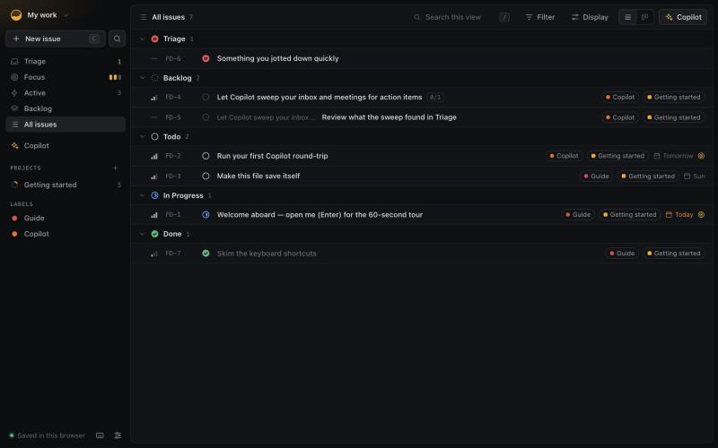
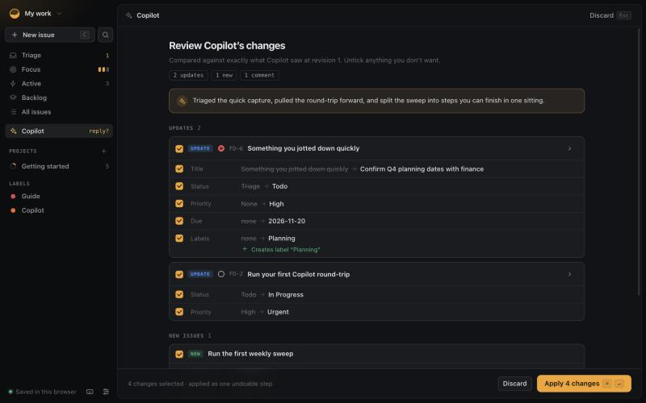

# Flight Deck

A Linear-style task board that is a single HTML file. It runs entirely in your browser, on your device. An AI assistant such as Copilot can help you maintain the board, but only through text you copy and paste yourself.

**Open it:** https://daveonkels.github.io/flight-deck/



## Entirely local

Flight Deck has no server side. There is no account, no sync, no backend and no database other than the one inside your own browser.

- **No metrics.** No analytics, telemetry, tracking, cookies, error reporting or usage counters of any kind.
- **No off-device saving.** Your board is never uploaded, backed up or synced anywhere by the app.
- **No third parties.** No CDNs, web fonts, external scripts or embedded services. The app has zero dependencies.
- **The app cannot make network requests.** This is enforced by the browser, not just promised. The page ships with this Content Security Policy:

  ```
  default-src 'none'; connect-src 'none'; script-src 'unsafe-inline'; style-src 'unsafe-inline';
  img-src 'self' data: blob:; manifest-src 'self'; worker-src 'self';
  base-uri 'none'; form-action 'none'; object-src 'none'
  ```

  `connect-src 'none'` blocks every `fetch`, XHR, WebSocket and beacon. The source contains none of those calls in the first place.

### Where your board is kept

| Place | When |
| --- | --- |
| IndexedDB in your browser profile, on your device | Always |
| A daily snapshot, also in that browser, for the last ten days of use | Always |
| A file on your own disk that you pick | Only if you turn on "Save into this file" |
| A downloaded copy or JSON export | Only when you click Download or Export |

### The honest fine print

- **Loading the app from this address** downloads its static files (the page, a manifest, three icons and a service worker) from GitHub Pages. Like any web host, GitHub can log that a request was made. Nothing about your board is in that request. After the first visit the service worker serves the app from your browser's cache, and it only ever requests those same files from this same address.
- **To avoid even that**, download `index.html` and open it from your disk. Used that way it involves no network at all.
- **The Copilot loop is copy and paste.** Flight Deck puts a prompt on your clipboard; you choose whether to paste it into an assistant, and you paste the reply back. That is the only way board content leaves your device, and it only happens when you do it.
- **Links** you write in descriptions open only when you click them.

### Check it yourself

`index.html` is one readable, unminified file. Search it for `fetch(`, `XMLHttpRequest`, `WebSocket` or `sendBeacon`: there are no matches. Or open your browser's developer tools, watch the Network tab, and use the app.

## What it does

- Grouped list and drag-and-drop board, full issue pages with Markdown, sub-issues, comments and history
- Projects, labels, saved views, filters, a Triage inbox and a short Focus list
- Keyboard first: `⌘K` for everything, `C` to create, `J`/`K` to move, `S` `P` `L` `D` to edit the issue under the cursor, `X` to select, `⌘Z` to undo, `?` for the full list
- Light and dark themes

### Working with an assistant



1. Select issues and press `E`, or open **Copilot** and pick a recipe (Triage, Enrich, Break down, Plan my focus, Review my board, and more). A prompt is copied.
2. Paste it into your assistant.
3. Copy the reply and press `⌘V` anywhere on the board.
4. Review the diff. Untick anything you don't want, then apply. It is one undo step.

Replies are checked against exactly what the assistant was shown. A field you edited in the meantime is flagged and left unticked, and a bad id or date is skipped on its own instead of rejecting the whole reply.

## Use it

- **In the browser:** open the address above.
- **As a desktop app:** in Edge or Chrome, use the install icon in the address bar. It gets its own window and icon and starts offline.
- **From a file:** download `index.html` and open it. It works from disk with no web server. "Download a copy" inside the app gives you the same file with your board inside it.

A board opened from this address and a board opened from a file are stored separately. Move between them with Settings → Import.

## In this repository

This is the built app only.

| File | Purpose |
| --- | --- |
| `index.html` | The whole app: markup, styles and scripts in one file |
| `manifest.webmanifest`, `icon-*.png`, `favicon.svg` | Name and icons for installing it |
| `sw.js` | Service worker that keeps the app available offline |
